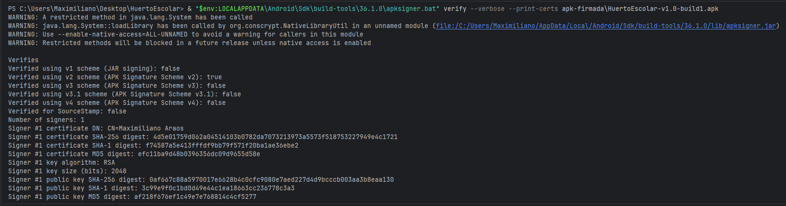
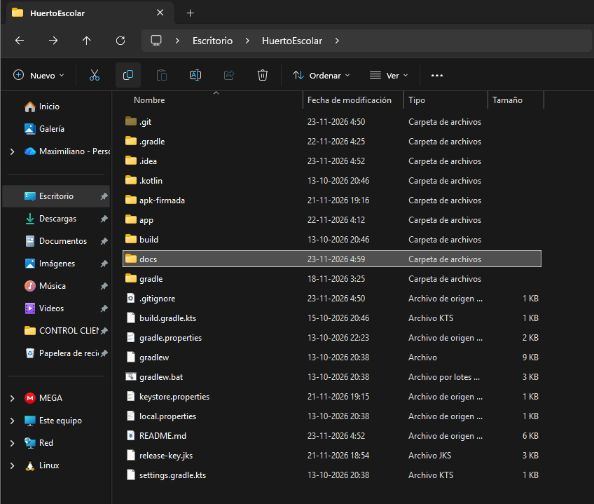

# Huerto Escolar - Android App

Huerto Escolar es una aplicación móvil nativa para Android desarrollada en **Kotlin** y **Jetpack Compose**. Representa una solución integral para la gestión, seguimiento participativo y registro de cultivos, sectores y tareas dentro de un huerto escolar, separando permisos y flujos según el rol del usuario (Administrador y Estudiante).

Los sectores y cultivos se leen y escriben en un microservicio propio hecho con Spring Boot, y la app consume además una API externa del clima.

## Autor

- **Estudiante:** Maximiliano Araos
- **Asignatura:** Desarrollo de Aplicaciones Móviles (DSY1105)
- **Institución:** Duoc UC
- **Evaluación:** Parcial 4 (continuación de HuertoEscolar)

## Repositorios

- Aplicación Android (este repositorio): https://github.com/m4x1fr4nc1sco8/HuertoEscolar
- Microservicio Spring Boot: https://github.com/m4x1fr4nc1sco8/HuertoBackend (README con la lista completa de endpoints)

## Funcionalidades implementadas

### Autenticación y control de roles

- **Acceso y registro:** inicio de sesión y registro de usuarios con validación de campos. Los usuarios se guardan en Room.
- **Roles (RBAC):**
  - **Administrador:** gestión de sectores, registro de cultivos y asignación/revisión de tareas.
  - **Estudiante:** consulta de información y resolución de tareas asignadas.

### Gestión de sectores y cultivos

- Registro y listado de sectores del huerto con estado visual.
- Formulario de cultivos con fecha de siembra, cosecha estimada y frecuencia de riego.
- Validaciones desacopladas de la interfaz (`domain/validation`).

### Consumo de microservicio y API externa

- **Microservicio propio (Spring Boot):** crear, listar, editar y eliminar sectores y cultivos mediante Retrofit. Room funciona como copia local de los datos del servidor.
- **Aviso sin conexión:** la app informa cuando no puede comunicarse con el servidor.
- **API externa del clima:** consulta del clima de San Bernardo con Open-Meteo.

### Recursos nativos del dispositivo

1. **Cámara nativa:** captura directa de fotografías para evidencias y fotos referenciales con `ActivityResultContracts.TakePicture`.
2. **Galería / selector visual:** selección de imágenes desde el almacenamiento del dispositivo con `ActivityResultContracts.PickVisualMedia`.

## Endpoints utilizados

### API externa: Open-Meteo (clima)

API pública y gratuita, sin clave: https://open-meteo.com

| Método | Endpoint | Descripción |
|--------|----------|-------------|
| GET | `v1/forecast` | Clima actual y pronóstico de 3 días para las coordenadas de San Bernardo |

Parámetros que envía la app (definidos en `ClimaApi.kt`):

| Parámetro | Valor |
|-----------|-------|
| `latitude`, `longitude` | Coordenadas de San Bernardo |
| `current` | `temperature_2m, relative_humidity_2m, wind_speed_10m, weather_code` |
| `daily` | `weather_code, temperature_2m_max, temperature_2m_min, precipitation_probability_max` |
| `timezone` | `America/Santiago` |
| `forecast_days` | `3` |

La respuesta se muestra en la interfaz con temperatura, humedad, viento y el pronóstico de los próximos días.

### Microservicio propio: huerto-api (Spring Boot)

URL base desde el emulador: `http://10.0.2.2:8080/`. Documentación interactiva en Swagger: http://localhost:8080/swagger-ui.html

**Sectores**

| Método | Endpoint | Descripción |
|--------|----------|-------------|
| GET | `/sectores` | Listar sectores |
| GET | `/sectores/{id}` | Obtener un sector |
| POST | `/sectores` | Crear un sector (409 si el código ya existe) |
| PUT | `/sectores/{id}` | Actualizar un sector |
| DELETE | `/sectores/{id}` | Eliminar un sector (409 si tiene cultivos asociados) |

**Cultivos**

| Método | Endpoint | Descripción |
|--------|----------|-------------|
| GET | `/cultivos` | Listar cultivos (filtros opcionales: `estudianteId`, `sectorId`) |
| GET | `/cultivos/{id}` | Obtener un cultivo |
| POST | `/cultivos` | Crear un cultivo |
| PUT | `/cultivos/{id}` | Actualizar un cultivo |
| DELETE | `/cultivos/{id}` | Eliminar un cultivo |
| PATCH | `/cultivos/{id}/estado` | Cambiar el estado del cultivo |
| POST | `/cultivos/{id}/tarea/enviar` | Enviar la tarea con foto y comentario |
| POST | `/cultivos/{id}/tarea/validar` | Validar la tarea (administrador) |
| POST | `/cultivos/{id}/tarea/rechazar` | Rechazar la tarea con un motivo (administrador) |

La lista completa, con los usuarios y los códigos de respuesta, está en el README del microservicio: https://github.com/m4x1fr4nc1sco8/HuertoBackend

## Arquitectura y tecnologías

- **Lenguaje:** Kotlin
- **UI:** Jetpack Compose (Material Design 3)
- **Arquitectura:** MVVM con separación por capas (`data`, `domain`, `ui`), repositorios inyectados por constructor y fábricas de ViewModel
- **Persistencia local:** Room Database (SQLite)
- **Red:** Retrofit con converter-gson
- **Navegación:** Jetpack Navigation Compose, con animaciones entre pantallas (`Crossfade`, `AnimatedVisibility`)
- **Carga de imágenes:** Coil 3 (`AsyncImage`)
- **Pruebas unitarias:** JUnit 4, MockK, kotlinx-coroutines-test y cobertura con Kover

## Estructura del proyecto

```
cl.duoc.huertoescolar/
├── data/
│   ├── local/         # Room (Entities, DAOs, AppDatabase)
│   ├── remote/        # Retrofit: interfaces de API, clientes y DTOs
│   ├── repository/    # Repositorios (microservicio, clima, Room)
│   └── session/       # Sesión del usuario actual
├── domain/
│   ├── model/         # Modelos de dominio y enums (Cultivo, Sector, Usuario, Tarea)
│   └── validation/    # Reglas de validación (Validaciones.kt)
├── ui/
│   ├── components/    # Componentes reutilizables (CampoTexto, CampoDesplegable)
│   ├── navigation/    # NavHost, rutas y transiciones
│   ├── screens/       # Pantallas principales
│   ├── theme/         # Tema visual y paleta verde del huerto
│   └── viewmodel/     # ViewModels, UiStates y fábricas
└── util/              # Helpers para fotos y etiquetas
```

## Cómo ejecutar el proyecto

### 1. Levantar el backend

1. Inicia **MySQL** desde XAMPP.
2. Importa `database/huerto_escolar.sql` del repositorio HuertoBackend en phpMyAdmin.
3. Ejecuta el microservicio (`.\mvnw spring-boot:run`, o `HuertoApiApplication` desde IntelliJ IDEA con JDK 25).
4. Comprueba que Swagger abre en http://localhost:8080/swagger-ui.html

Desde el emulador, la app accede al backend en `http://10.0.2.2:8080/`.

### 2. Ejecutar la app

1. Abre el proyecto en Android Studio y espera la sincronización de Gradle.
2. Usa el emulador **Pixel 8 con API 36** (minSdk 24).
3. Ejecuta la configuración `app`.

### Cuentas de prueba

| Rol | Correo | Contraseña |
|-----|--------|------------|
| Administrador | admin@huerto.cl | huerto1234 |
| Estudiante | estudiante@huerto.cl | huerto1234 |

## APK firmado y llave (.jks)

El APK firmado está en la carpeta `apk-firmada/`:

- `apk-firmada/HuertoEscolar-v1.0-build1.apk`

La llave y su configuración están en la raíz del repositorio:

- `release-key.jks`: llave de firma (alias `huertoescolar-release`).
- `keystore.properties`: ruta, alias y contraseñas de la llave.

El `.jks` y `keystore.properties` se incluyen en el repositorio solo para la evaluación académica (llave de uso exclusivo del curso).

### Configuración técnica de la firma

- En `app/build.gradle.kts`, el bloque `signingConfigs` lee `keystore.properties` y el tipo de compilación `release` aplica esa firma.
- La tarea `exportarApkRelease` compila el APK release firmado y lo copia a `apk-firmada/` con el nombre `HuertoEscolar-v1.0-build1.apk`:

```powershell
.\gradlew exportarApkRelease
```

### Captura del APK firmado y .jks

Verificación de la firma con `apksigner` (resultado `Verifies`, esquema v2 en `true`, firmante `CN=Maximiliano Araos`):

```powershell
apksigner verify --verbose --print-certs apk-firmada\HuertoEscolar-v1.0-build1.apk
```



Archivo `release-key.jks` y `keystore.properties` en la raíz del proyecto:



### Instalación

```powershell
adb install apk-firmada\HuertoEscolar-v1.0-build1.apk
```

Si ya había una versión instalada con otra firma (por ejemplo la de debug), primero se desinstala con `adb uninstall cl.duoc.huertoescolar`.

## Pruebas unitarias

Las pruebas cubren la lógica de ViewModels, repositorios y validaciones. Para ejecutarlas y generar el informe de cobertura:

```powershell
.\gradlew testDebugUnitTest
.\gradlew koverHtmlReportDebug
```

El informe HTML queda en `app/build/reports/kover/htmlDebug/index.html`.

- **Pruebas:** 294 en verde
- **Cobertura de la lógica:** superior al 98 %
